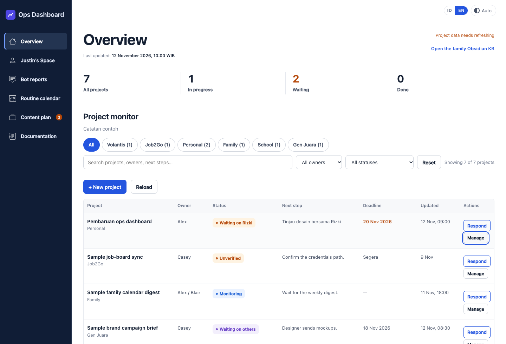
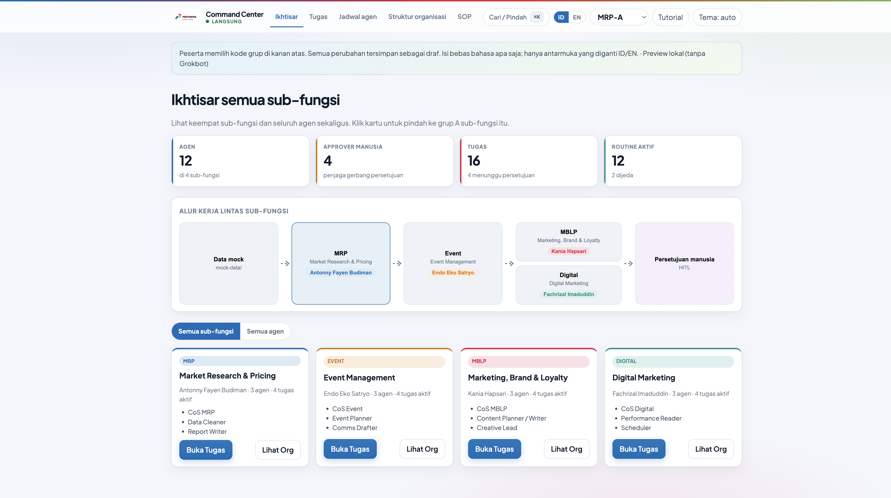
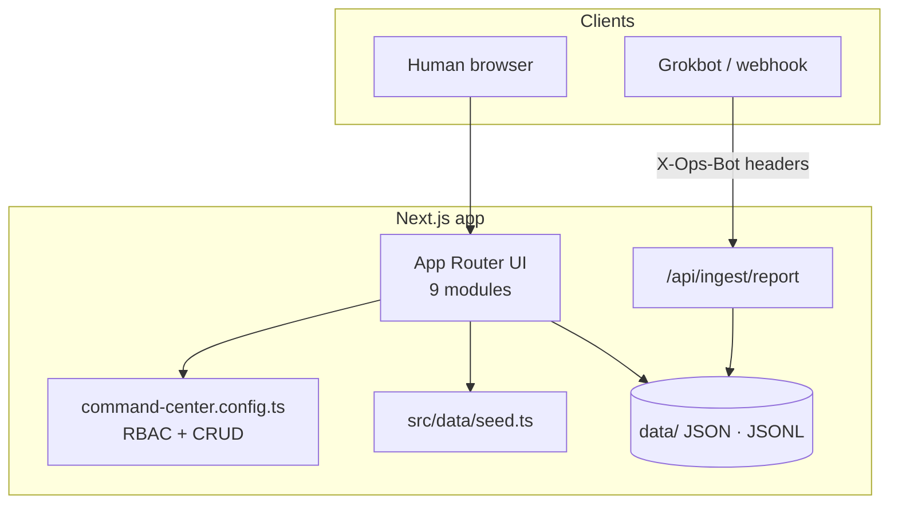

# Grokbot Command Center

**Mission Control for your agent fleet** — a single dashboard where humans steer projects, content, org structure, and Grokbot reports.

[](https://nextjs.org/)
[](LICENSE)
[](https://vercel.com/new)

Open-source template forked from real ops habits: portfolio tracking, editorial pipelines, scheduled bot digests, and an ingest API for your Grokbots.

---

## Screenshots

> Showcase assets live under `public/showcase/`. Additional hero shots may land shortly after the initial GitHub push.

| Ops dashboard | Patra command center | Mission control |
|---------------|----------------------|-----------------|
|  |  |  |

If an image is missing locally, pull latest or add your own captures after customizing the theme.

---

## Features

Nine coordinated modules, toggled in `src/config/command-center.config.ts`:

| Module | Purpose |
|--------|---------|
| **Overview** | Fleet KPIs, deadlines, anomaly highlights |
| **Projects** | Portfolio board with areas, owners, and SLAs |
| **Reports** | Grokbot report inbox and history |
| **Content** | Editorial pipeline with approval gates |
| **Org** | Department canvas and relationships |
| **Schedules** | Bot cadences and human runbooks |
| **Docs** | SOPs and internal references |
| **Inbox** | Action items needing human response |
| **About** | Brand story, ingest docs, deployment links |

Built-in **RBAC** (admin / approver / operator / viewer), per-module **CRUD policies**, EN/ID labels, dark-first UI, and demo seed data you can replace after onboarding.

---

## Quick start

**Requirements:** Node.js 20+, npm 10+

```bash
git clone https://github.com/jrrqd/grokbot-command-center.git
cd grokbot-command-center
npm i && npm run dev
```

Open [http://localhost:3000](http://localhost:3000). The app ships with demo state in `src/data/seed.ts` and optional JSON samples in `data/samples/`.

---

## Point your agent here

This repo is designed for **Cursor** (or any coding agent):

1. Open the folder in Cursor.
2. The agent reads **[AGENTS.md](./AGENTS.md)** and must run the **grill-me** onboarding when `customized: false`.
3. Follow **`.cursor/skills/customize-command-center/SKILL.md`** for the interview → blueprint → config implementation flow.

Until onboarding completes, agents should not ship random feature work on top of the template defaults.

---

## Connect Grokbots

Each bot in `command-center.config.ts` can set `ingest: true`. Reports arrive over HTTP:

### Ingest endpoint

```http
POST /api/ingest/report
Content-Type: application/json
X-Ops-Bot: <bot-id>          # must match bots[].id, e.g. lucius
X-Ops-Bot-Key: <secret>      # per-bot key from your environment
```

Example body (shape may evolve — see seed docs module):

```json
{
  "title": "Nightly digest",
  "summary": "7 projects tracked; no P0 errors.",
  "severity": "info",
  "tags": ["ops", "digest"]
}
```

### Keys and env

```bash
cp .env.example .env    # when present in your fork
npm run generate-bot-key -- lucius
```

Store returned keys in `.env` (never commit). Map each key to the bot id your Grokbot sends in `X-Ops-Bot`.

### Webhook forward

Point your Grokbot or automation webhook at:

```text
https://<your-deployment>/api/ingest/report
```

For nginx or another reverse proxy in front of the UI, **exempt** the ingest path from HTTP basic auth so bots can authenticate with headers only. See [`deploy/nginx.conf.example`](./deploy/nginx.conf.example).

---

## Deploy

### Vercel (recommended)

After you push to GitHub, deploy with one click (replace `YOUR_ORG`):

[](https://vercel.com/new/clone?repository-url=https%3A%2F%2Fgithub.com%2FYOUR_ORG%2Fgrokbot-command-center&project-name=grokbot-command-center&env=NEXT_PUBLIC_CC_DEMO&envDescription=Set%20to%201%20for%20demo%20banner)

Add bot ingest secrets in the Vercel project settings. `vercel.json` sets **no-store** cache headers on HTML routes so dashboard state stays fresh.

### Docker Compose

`next.config.ts` sets `output: 'standalone'` for the multi-stage image.

```bash
docker compose build
docker compose up -d
```

App listens on **3000**; persist live JSON/JSONL under `./data` via the mounted volume.

### VPS + nginx

1. Run the app (Docker or `npm run build && npm run start` behind systemd).
2. Copy [`deploy/nginx.conf.example`](./deploy/nginx.conf.example) into your site config.
3. Enable TLS (e.g. Certbot) and optional basic auth on `/`, while leaving `/api/ingest/report` open for bot headers.

---

## Configuration

Single source of truth: **`src/config/command-center.config.ts`**

| Area | What you control |
|------|------------------|
| `brand` | Name, tagline, accent, logo text |
| `modules` | Enable/disable the nine surfaces |
| `areas` | Work domains and colors |
| `bots` | Fleet roster and `ingest` flags |
| `rbac` | Roles, default role, per-module permissions |
| `crud` | `read_only`, `draft_only`, `full_crud`, `gated_approval` |
| `contentStatuses` / `contentActions` | Pipeline vocabulary |

Set `customized: true` only after grill-me onboarding is approved.

Sample exports for development: `data/samples/` (committed). Live persistence files at `data/*.json` and `data/*.jsonl` are gitignored.

---

## Architecture



---

## Heritage

Grokbot Command Center distills patterns from:

- **Ops dashboard** — portfolio + content ops in one dark room
- **Patra Niaga command center** — executive-friendly mission control for distributed agents

You're welcome to re-skin, trim modules, or harden auth for production; the template stays intentionally honest about being demo-first until you customize it.

---

## Scripts

| Command | Description |
|---------|-------------|
| `npm run dev` | Local development (Turbopack) |
| `npm run build` | Production build (standalone output) |
| `npm run start` | Serve production build |
| `npm run lint` | ESLint |
| `npm run generate-bot-key` | Generate ingest key material for a bot id |

---

## License

[MIT](LICENSE) — use, fork, and deploy freely; attribution appreciated.